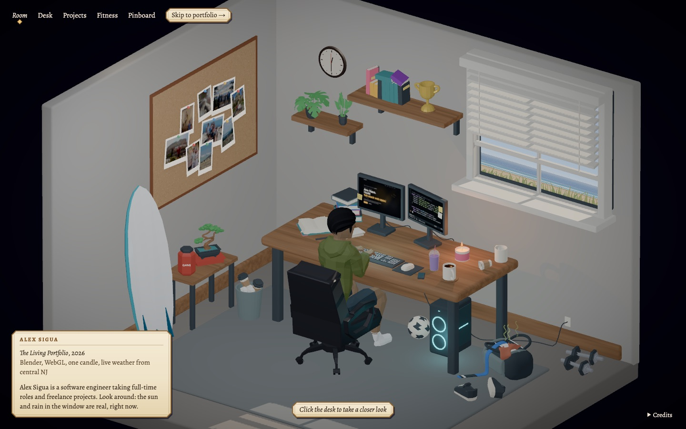
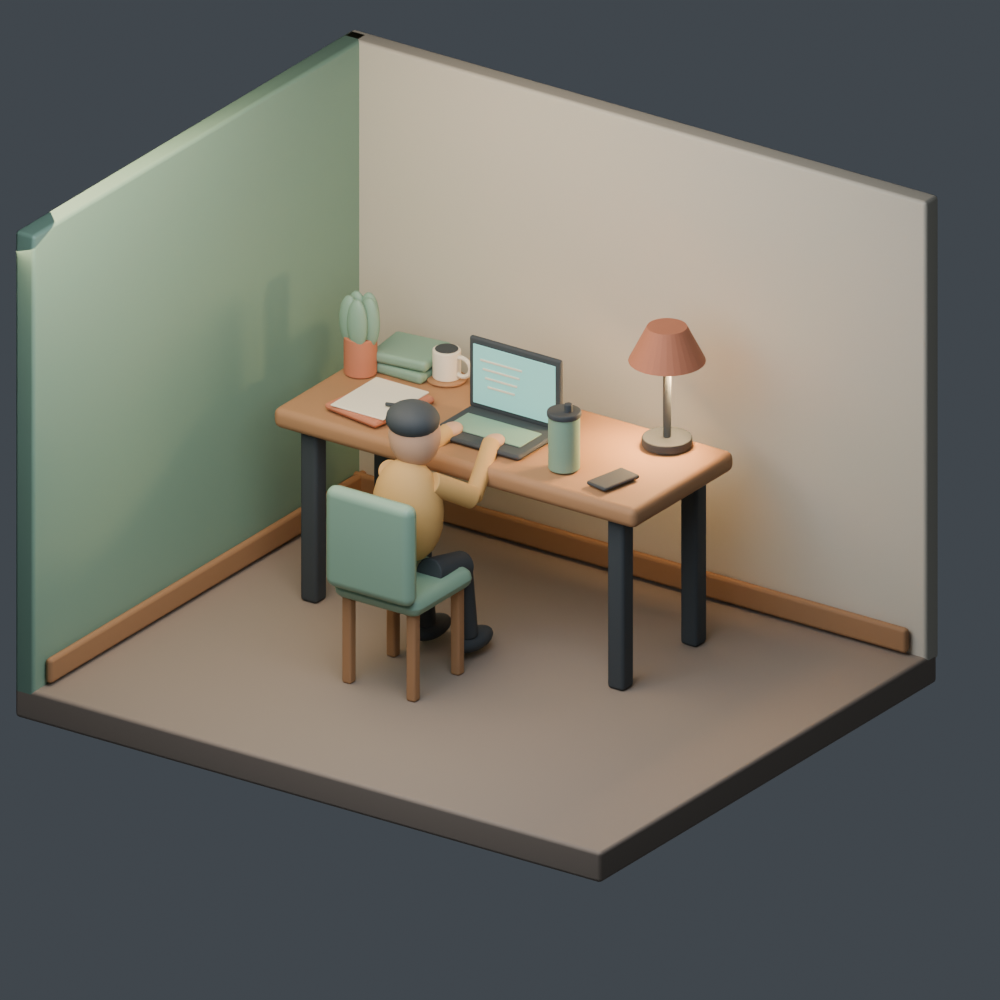
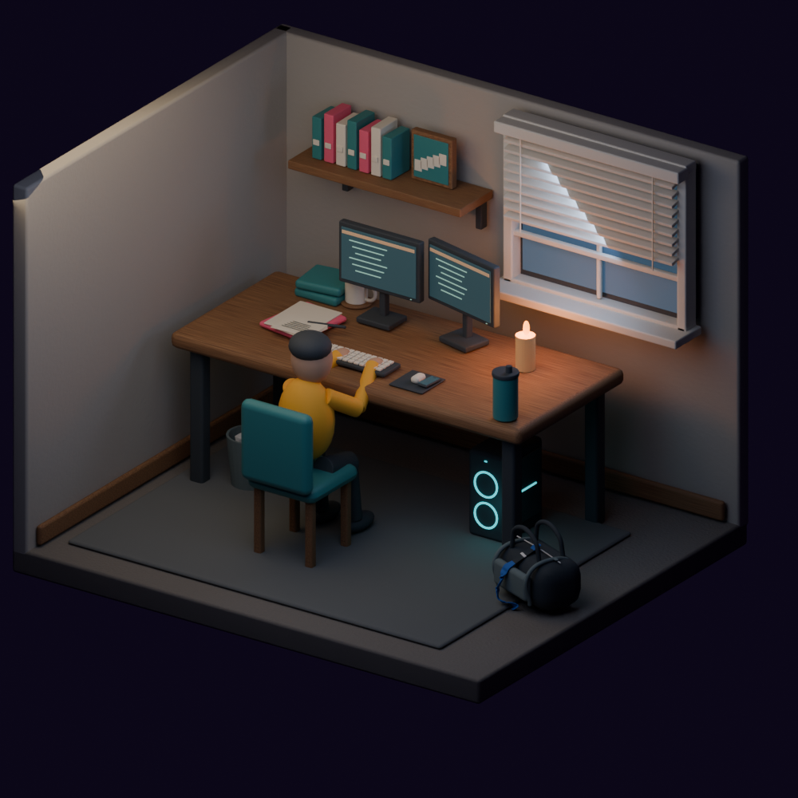

# The Living Portfolio

A cozy 3D room you can look around in a browser. A developer sits at a cluttered corner desk, the window shows the real
sun, moon and weather over the New Jersey coast right now, and clicking the desk's main monitor opens my actual
portfolio site, live, on the screen. It's the front door of [alexsigua.com](https://alexsigua.com).

The whole scene is written as Python, built headlessly in Blender, exported to a single GLB file, and rendered with
React Three Fiber. Most of it was built with AI coding agents driving Blender, under the measured checks and lessons
recorded in this repo.

<p align="center">
  
</p>

## What you can do in the room

- **Look closer:** click the desk for an angled bird's-eye view, and click again to sit at the computer.
- **Open the portfolio:** the main monitor runs the live personal site in an iframe. Leave it with Esc or "Leave
  computer", or pop it out to full screen.
- **Check the weather:** the window's sky follows the real sun and moon position and live National Weather Service
  observations (clear, cloud, rain, snow, storm), with no API key and no backend.
- **Poke things:** blow out the candle, tilt the blinds, and open the pinboard to spread out the photos. The corner
  holds skis in winter and a surfboard the rest of the year.
- **Use any input:** every view is reachable from a plain text menu by keyboard. With JavaScript off, the page still
  shows the name and a working link to the portfolio.

## Engineering highlights

- **The scene is code.** [`build_scene.py`](blender/scripts/build_scene.py) builds the room from 24 prop modules in
  [`blender/scripts/props/`](blender/scripts/props). A saved `.blend` is a checkpoint, never the source.
- **Measured, not eyeballed.** [`check_scene.py`](blender/scripts/tools/check_scene.py) tests contact, overlaps and
  sizes in millimetres, and every known flaw is capped at its measured size, so a worse one fails.
  [`check_glb.py`](blender/scripts/tools/check_glb.py) checks the exported file against the names the browser relies
  on. Each check exists because a good-looking render once hid a real fault (see
  [lessons](.agent/lessons.md)).
- **One camera owner.** [`CameraRig.tsx`](web/src/CameraRig.tsx) moves one perspective camera through a ladder of
  views (Room → Desk → Computer) on damped springs. A 1° lens gives the diorama a near-orthographic look, and it opens
  to 38° as you sit down, with no camera swap.
- **Two apps, one contract.** The personal site is a separate repository. The room serves a copy of its build and
  embeds it on the monitor, and the site asks to leave through a versioned, origin-checked `postMessage`.
- **Real sky, computed locally.** [`sun.ts`](web/src/sun.ts) works out sun and moon position from the time alone, and
  [`weather.ts`](web/src/weather.ts) falls back cleanly when the weather service is unreachable.
- **Static hosting as code.** [`infra/site.yml`](infra/site.yml) is one CloudFormation stack: a private S3 bucket
  behind CloudFront, plus ACM, Route 53, security headers and a budget alert. [`deploy.mjs`](web/scripts/deploy.mjs)
  refuses to ship uncommitted work.
- **Provenance for every asset.** Each third-party model and font has its author, source and license in
  [`ASSET_MANIFEST.csv`](assets/ASSET_MANIFEST.csv), and CC-BY authors are credited in the room.

## How it was built

<p align="center">
  
  
</p>

Version 1 was a blockout. Version 15 added candlelight, two monitors and a window. The current room is version 38.
Each change ends with a review sheet that shows the scene from several angles, like the
[v037 sheet](blender/renders/corner-desk-v037-review.png), checked alongside the numbers.

## Tech stack

| Area | Choice |
|---|---|
| 3D content | Blender 5.2 LTS, built headlessly from Python |
| Front end | React 19, TypeScript, Vite |
| 3D in the browser | Three.js via React Three Fiber, Drei and postprocessing |
| Data | National Weather Service API, called from the browser |
| Hosting | AWS S3 + CloudFront, Route 53 and ACM, via CloudFormation |
| CI | GitHub Actions: diff check, secret scan, public-safety check, agent-kit check |

## Run it locally

Requires Node.js 22. The exported scene is committed, so Blender isn't needed to view it.

```bash
cd web
npm ci
npx vite
```

Open the printed URL. The main monitor's site lives in a separate private repository, so here it shows the room
again; everything else works. [Setup](docs/SETUP.md) covers the full development loop, scene export and Blender.

## Project layout

| Path | Contents |
|---|---|
| `blender/scripts/` | Scene source: `build_scene.py`, `props/`, shared `lib/`, and checks and export in `tools/` |
| `blender/scenes/` | The current `.blend` checkpoint |
| `assets/` | Licensed source models, the exported GLB, and the provenance manifest |
| `web/src/` | The room: scene, camera, sky, reactions, monitors and phone |
| `web/scripts/` | Scene export, site assembly, sky and screen checks, deploy |
| `infra/` | CloudFormation for hosting |
| `docs/` | Spec, architecture decisions, status, setup, testing and deploy |
| `AGENTS.md`, `.agent/` | Instructions, limits and lessons for the AI coding agents that work on this repo |

Start with [architecture](ARCHITECTURE.md), then the [documentation index](docs/README.md).
[Contributing](CONTRIBUTING.md) has the workflow and the public-safety rules.

## License

- **Code and scripts:** [MIT](LICENSE).
- **Third-party models and fonts:** their own licenses (CC-BY, CC0/public domain, SIL OFL), listed in
  [`assets/ASSET_MANIFEST.csv`](assets/ASSET_MANIFEST.csv) and credited in the room.
- **Personal photos, name and likeness:** all rights reserved. They aren't licensed for reuse.
